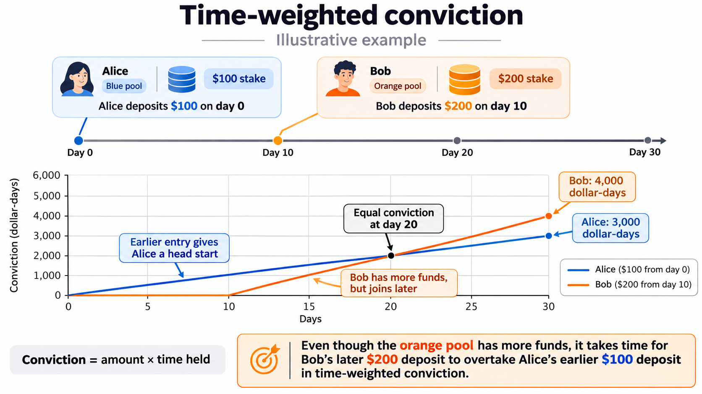
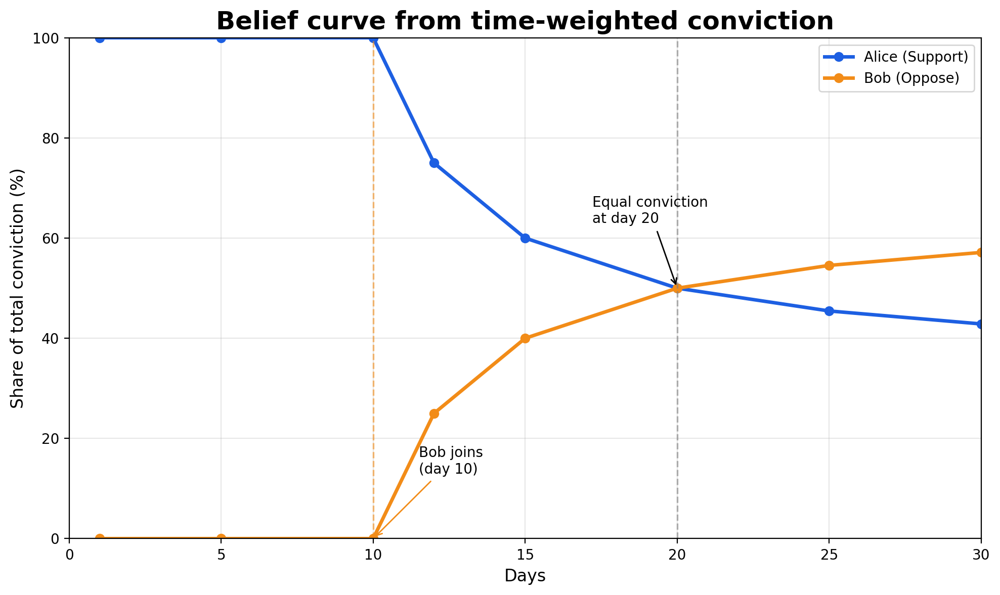
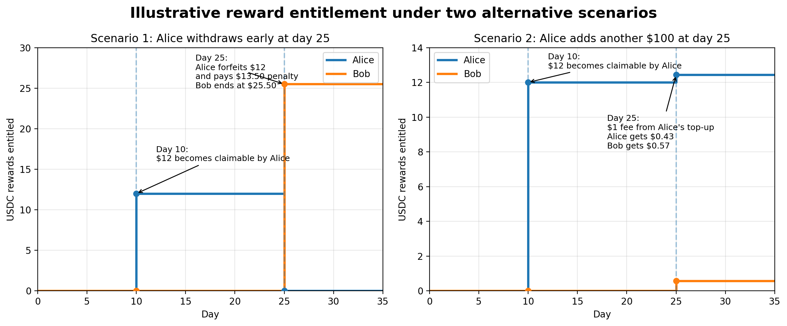

# Belief Markets: An Escrowed Seriousness Primitive

Smart contracts for serious belief coordination on Ethereum. Users stake USDC to signal durable belief on claims, with time-weighted mechanisms that reward patience over speed.

## Motivation

Modern social platforms optimize for short-term engagement, cheap expression, and virality. This results in weak signal, no accountability, and no durable representation of belief.

Prediction markets solve signal extraction but require objective resolution, are adversarial and zero-sum, and feel like gambling.

**Escrowed seriousness** is a different approach: capital temporarily locked to signal durable belief. The key insight is that *how long* capital stays matters more than how fast it moves.

### Design Principles

- **No objective truth resolution** — beliefs are subjective, markets never settle to "true/false"
- **Non-zero-sum** — rewards come from bounded fees, not others' losses
- **Time > Volatility** — signal is created by duration, not speed
- **Patience is rewarded** — early exits earn little, flash moves are dampened
- **Explicit safety rails** — caps on rewards, no leverage, no liquidation

## Architecture

```
BeliefFactory
    ├── deploys BeliefVault (one per factory, holds all USDC)
    └── creates BeliefMarket (one per post)
            ├── Support Pool
            ├── Oppose Pool
            └── Signal Reward Pool (SRP)
```

Users approve the vault once. Markets never hold tokens directly — they call the vault to pull and release USDC on behalf of users. Per-market balance isolation in the vault prevents a compromised market from draining funds belonging to other markets.

### Core Contracts

| Contract | Description |
|----------|-------------|
| `BeliefFactory` | Creates BeliefMarket instances using EIP-1167 minimal proxies, deploys and owns the vault |
| `BeliefMarket` | Manages positions, calculates belief curve and rewards, delegates custody to the vault |
| `BeliefVault` | Centralized USDC custody with per-market balance tracking and access control |

## Key Formulas

### Time-Weighted Signal

<p align="center">
  
</p>

<p align="center">
  <sub><em>
    Figure 1. Although Bob stakes twice as much as Alice, her ten-day
    head start means their conviction doesn't become equal until day 20.
  </em></sub>
</p>

Each side (Support/Oppose) maintains:
- `P` = total principal
- `S` = sum of (deposit_amount × deposit_timestamp)

The time-weighted signal at time `t`:

```
W(t) = t × P - S
```

This is O(1) — no iteration over deposits required.

### Belief Curve

<p align="center">
  
</p>

<p align="center">
  <sub><em>
    Figure 2. Although Bob's $200 stake gives him twice Alice's capital, her ten-day head start keeps her belief share above 50% until day 20. After that, Bob's conviction overtakes hers, gradually shifting the balance toward the Oppose side. Note that the belief curve is non-linear, even though time-weighted conviction accrues linearly.
  </em></sub>
</p>

```
belief(t) = W_support(t) / (W_support(t) + W_oppose(t))
```

Returns a value from 0 to 1, representing where time-weighted capital sits across stances.

### Reward Calculation (O(1) Synthetix-style)

Rewards use a dual-accumulator pattern adapted for time-weighted stakes:

```
A = Σ (reward × timestamp / totalWeight)    // global accumulator
B = Σ (reward / totalWeight)                // global accumulator

pending = amount × (ΔA - depositTime × ΔB)
```

Each position snapshots A and B at deposit/claim time. This achieves constant-time reward calculation regardless of how many fee events have occurred.

<p align="center">
  
</p>

<p align="center">
  <sub><em>
    Figure 3. Alice creates the market with $100 on day 0 ($90 staked after the 10% creator premium) and Bob stakes $200 on day 10. Bob's $2 late-entry fee releases the held $10 premium, and both go to Alice, the only staker with weight: $12. If Alice withdraws early on day 25, she forfeits that $12 and pays a $13.50 penalty, and both go to Bob, the only remaining staker. If she instead adds another $100, the $1 entry fee is split by conviction at that moment: $0.43 to Alice and $0.57 to Bob.
  </em></sub>
</p>

### Late Entry Fee

```
feeBps = min(baseFee + totalPrincipal / scale, maxFee)
```

Scales with market size. First staker pays no fee.

## Fee Sources

1. **Author Challenge Premium** — percentage of author's initial commitment (signals willingness to be challenged)
2. **Late Entry Fee** — graduated fee when joining an already-active market (scales with total principal)
3. **Early Withdrawal Penalty** — penalty for withdrawing before the lock period expires (skipped if no remaining stakers)

All fees flow to the Signal Reward Pool and are distributed to stakers based on time-weighted contribution.

## Safety Rails

| Parameter | Purpose |
|-----------|---------|
| `lockPeriod` | Principal locked for duration (e.g., 30 days) |
| `minRewardDuration` | Minimum stake time before rewards accrue |
| `earlyWithdrawPenaltyBps` | Penalty for withdrawing before lock expires (feeds SRP) |
| `minStake` / `maxStake` | Bounds on individual stake amounts |

## Simulator

`web/index.html` is an interactive model of a single market: add agents and commit / claim / withdraw events, then watch time-weighted conviction, the belief curve, reward entitlement and each agent's net USDC update together. It replays events through the same fee and accumulator logic as `BeliefMarket.sol` (in floating point), with presets for the deploy-script parameters and for the scenarios in Figures 1–3.

It is a single self-contained file with no build step: open it in a browser, or serve the `web/` directory.

## Usage

### Build

```shell
forge build
```

### Test

```shell
forge test
```

### Format

```shell
forge fmt
```

## What This Is Not

- Not prediction markets (no resolution)
- Not creator tokens (no speculation on people)
- Not engagement farming (cost to participate)
- Not gambling (non-zero-sum, capped rewards)

This is **infrastructure for serious belief coordination**.

## License

MIT
